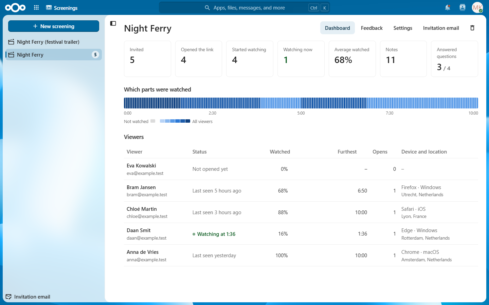
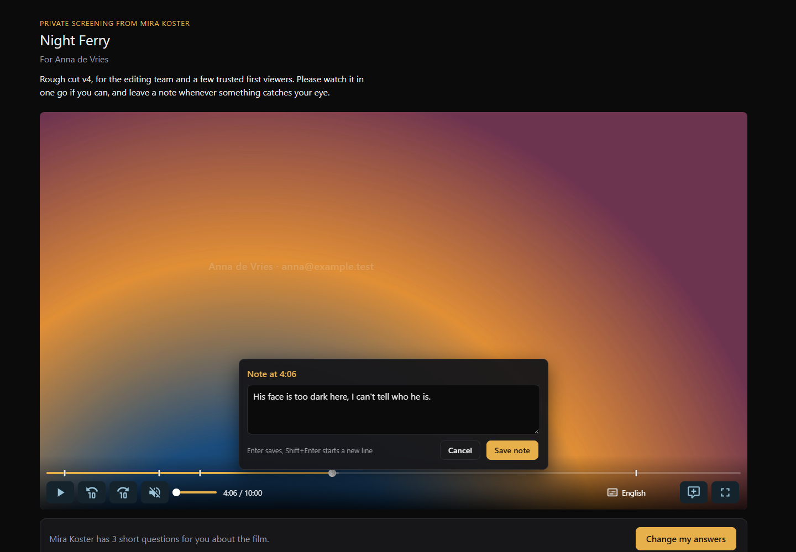
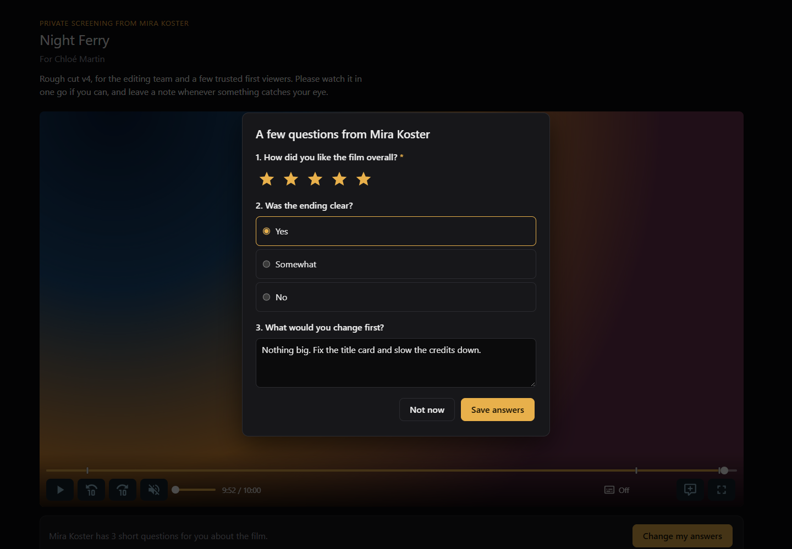
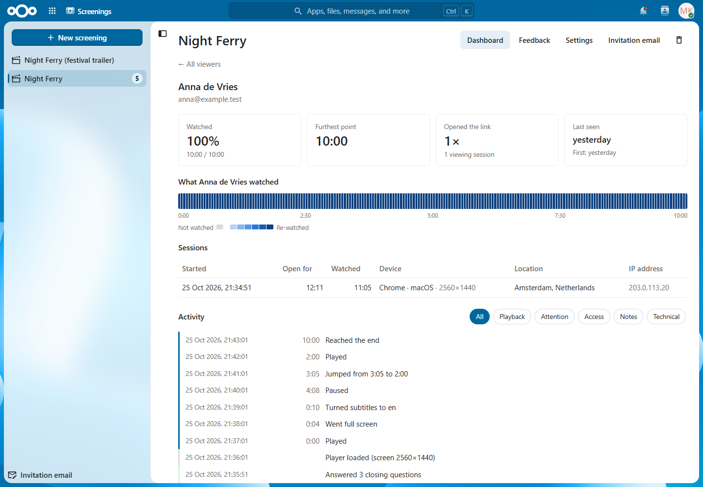
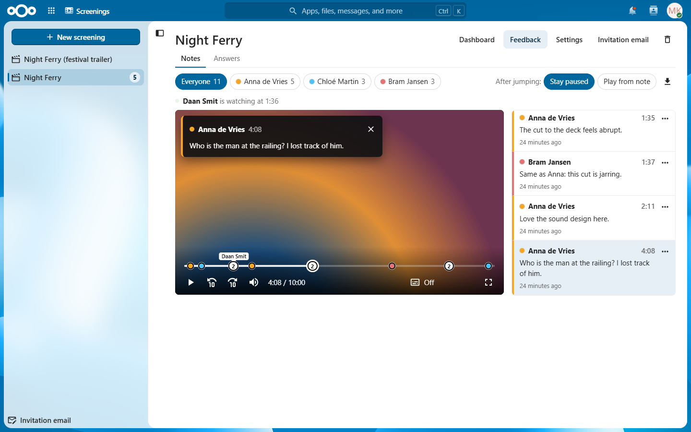
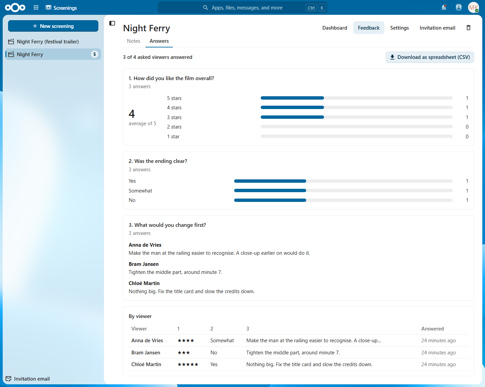
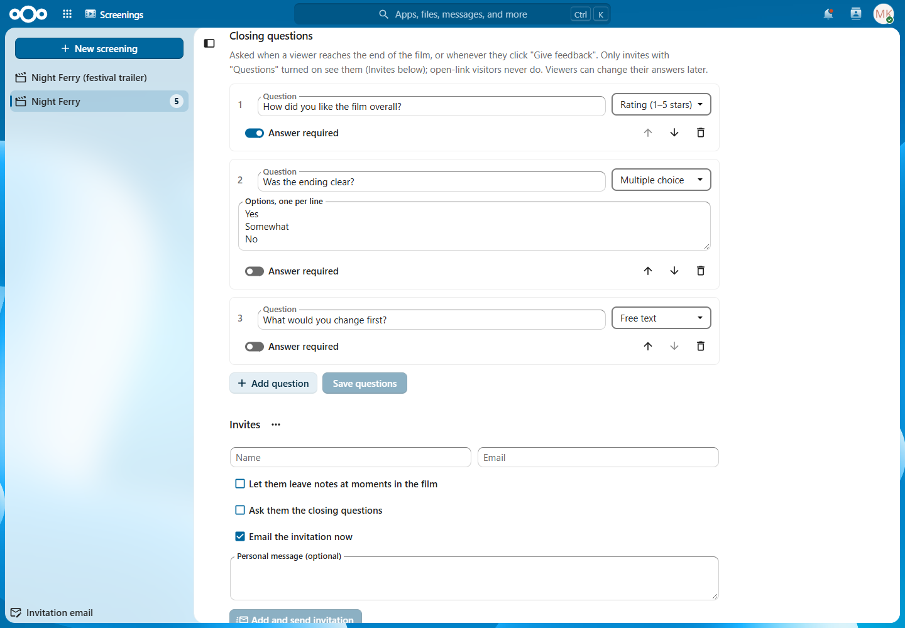
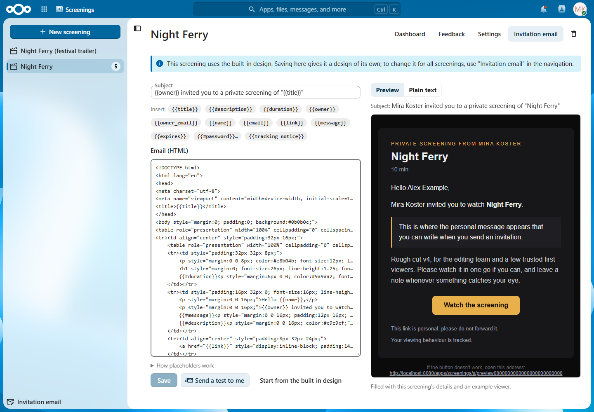

# Screenings

**Private, tracked film screenings from your own Nextcloud.**

Screenings is a Nextcloud app for filmmakers who send cuts to people they trust: an editor, a producer, a festival programmer, a handful of first viewers. You pick a video in your Nextcloud Files, invite people by email, and each of them gets a personal link to a dark, distraction-free screening page. You then see exactly how each person watched: whether they opened it, how far they got, what they skipped or watched twice. And you can ask for their feedback: notes at moments in the film, and a few questions at the end.

Nothing leaves your server. There is no third-party video host, and the film is only ever streamed to an open screening page, never offered as a download.



## What it does

- **Send a film privately.** Personal links per viewer, sent by email in a design you can change, or copied and shared yourself. Optionally a password, an expiry date, and an open link that anyone can use after confirming their email address.
- **A proper screening room.** Viewers get a clean player with subtitles, quality choice and full screen, and pick up where they left off when they come back. An optional moving watermark shows their name and email over the film.
- **See how it was watched.** A dashboard per screening with live status, a heatmap of which parts were actually played, and per viewer every play, pause, jump, subtitle change and device.
- **Collect feedback.** Viewers can leave notes at a moment in the film and answer a few closing questions. You review the notes in your own player, with every note as a marker on the timeline, and see the answers summarised. Both update live while you have the page open.
- **Any video.** Browser-ready MP4s stream as they are; other formats (ProRes, MKV, HEVC, DNxHR, …) are converted on your server with ffmpeg if you allow it.
- **Hard to copy.** Media is only served to an open screening page, in short-lived, encrypted pieces, never faster than about three times real time. Copying a link into a download tool doesn't work.
- **Privacy built in.** An editable notice tells viewers they are tracked, viewing data is deleted after a retention period you choose, and everything goes when you delete the invite or the screening.

## A tour

### The screening room

Each viewer opens their own link. The page is dark and quiet, so the film comes first. The player has subtitles, quality selection, keyboard shortcuts and full screen. When the owner asks for notes, the viewer presses **N** (or the note button) at any moment: the film pauses, a note box opens stamped with the time, and **Enter** saves it and plays on.



When the film ends (or whenever they click **Give feedback**), viewers get the closing questions you set: a star rating, multiple choice or free text. They can change their answers later.



### How it was watched

The dashboard (above) shows who was invited, who opened the link, who started, who is watching right now and how much of the film people saw on average. The heatmap shows which parts of the film were actually played. Click a viewer for the full story: their sessions with device, screen and location, what they watched and re-watched, and a filterable timeline of everything they did.



### Feedback: notes

The **Feedback** tab plays the film for you, with every viewer's notes as coloured markers on the timeline. Click a marker, or a note in the list beside the video, to jump there; the note appears over the picture, in full screen too. Choose whether the film then stays paused or plays on. The page is live: new notes appear within seconds, and you see who is watching right now and where (the "Daan Smit" pin on the timeline). Download all notes as a spreadsheet, or as a subtitle file to load straight into your editing timeline.



### Feedback: answers

Ratings are averaged with their spread, choices counted, free-text answers listed, and a table shows every viewer's answers side by side. Download them as a spreadsheet.



### Setting up a screening

Create a screening from the **New screening** button, or right from the Files app (**Create screening** on any video). In Settings you choose the video, password, expiry, open link, watermark, tracking notice and retention period, manage subtitles and closing questions, and add invites. Per invite you decide whether they can leave notes and get the closing questions.



The invitation email is yours to design: HTML with placeholders such as `{{name}}`, `{{title}}` and `{{link}}`, a live preview, and test sends to yourself. Set one design for all your screenings, and override it per screening.



## Using it

### Video formats

Each screening has a delivery mode. **Auto** (the default) works out the best way to serve the video you picked:

| Your video | What happens | Needs |
|---|---|---|
| MP4 or MOV that browsers play (H.264 8-bit, AV1 or VP9, with AAC, Opus or FLAC sound) | Streamed as it is, ready straight away | nothing |
| H.264 in another container (MKV, …) | Repackaged, takes seconds to minutes | ffmpeg |
| H.264 with PCM or Dolby sound | Only the sound is converted | ffmpeg |
| ProRes, DNxHR/MXF, HEVC, 10-bit or 4:2:2 H.264, … | Fully converted to H.264 in up to three qualities (1080p, 720p, 480p); takes roughly the film's own runtime | ffmpeg, full conversion allowed |

Converted films are stored encrypted (AES-128) in the app's data, and the portal shows what Auto decided and how far a conversion is. You can also choose a mode yourself: **Direct MP4**, **Pre-packaged HLS** (you upload an HLS export; see [docs/prepare-hls.md](docs/prepare-hls.md)) or **Server transcode**. Conversion is off until an administrator turns it on (*Administration settings → Screenings*).

### Subtitles

Upload `.srt` or `.vtt` files by hand, or put them next to the video in your Files, named the way media players expect. They are picked up automatically, also when you add or change such a file later; a changed file replaces its subtitle, and deleting a file never removes a subtitle viewers already have.

| File next to `film.mp4` | Shows as |
|---|---|
| `film.en.srt`, `film.eng.srt`, `film.English.srt` | English |
| `film.nl.srt`, `film.Nederlands.srt` | Nederlands |
| `film.pt-BR.vtt` | Português (Brasil) |
| `film.en.sdh.srt` (also `.cc`, `.hi`) | English (SDH) |
| `film.nl.forced.srt` | Nederlands (forced) |
| `film.en.default.srt` | English, switched on by default |
| `film.srt` | Subtitles |

Files with any other word after the video's name are ignored (`film-trailer.en.srt` belongs to another video). For an existing screening, **Add subtitles from the video's folder** in Settings picks up what isn't there yet.

### Inviting people

- **Personal invites:** a name and an email address. Send the invitation by email right away, later, or copy the link and share it yourself. Revoke access at any time; playback stops within seconds.
- **Open link:** one link for anyone. Visitors confirm their email address with a code before they can watch, and then continue on a personal link of their own. Visitors who requested a code but never entered it are listed on the dashboard.
- **Password and expiry:** a screening password (not included in the email; share it separately) and an end date after which nothing plays.
- **Notes and questions** are switched on per invite (when adding it, in its menu, or for everyone at once from the menu next to the Invites heading). Open-link visitors never get them.

### What is tracked

Everything a viewer does with the film: play, pause, jumps, the end, subtitles, quality, volume, full screen, buffering and errors, plus opening and leaving the page. Switching to another tab is only recorded while the film plays. You also see each session's browser, device, screen size and, if an administrator set up a GeoIP database, the city and country.

By default viewers see "Your viewing behaviour is tracked." on the screening page and in the invitation email. You can change that text or turn it off per screening; whether you may track without telling viewers depends on the privacy law where you live.

### Notes and closing questions

- **Notes:** viewers press **N** or the note button; the film pauses, they write, **Enter** saves and the film plays on. They see their notes as markers on the seek bar and in a list under the player, and can edit or delete them. At most 60 notes per viewer per hour, 2000 characters each.
- **Closing questions:** up to 10 per screening, each a 1–5 star rating, multiple choice or free text, optionally required. Asked when the film ends, or any time via **Give feedback**; someone who watched to the end earlier without answering gets a gentle reminder on their next visit. Deleting a question, or changing its kind, deletes its answers (the editor warns you first).
- **Reviewing:** *Feedback → Notes* and *Feedback → Answers*, both live (they refresh every 5 seconds while the page is visible). You get one Nextcloud notification per viewing session with notes ("Anna left 4 notes on …") and one per viewer who answers. Downloads: notes as CSV or SRT (one 4-second cue per note), answers as CSV.

### How the film is protected

A film is only streamed to a screening page that is open right now: every request needs that page's session cookie, a signal from the page every few seconds, and a short-lived token tied to the viewer's connection. Nothing far ahead of where the viewer is watching is sent, and an invite can't pull the film faster than about three times real time. One invite plays in one place at a time. Converted and HLS films are encrypted in pieces.

That stops copying a link into a download tool, and sharing a link that keeps working elsewhere. It can't stop screen recording, which only DRM could; the optional watermark puts the viewer's name and email on screen, so a leak can be traced to a person.

### Data retention and privacy

- Viewing data (sessions, watched parts, events) is deleted after each screening's retention period (default 365 days). The list of invites stays.
- Notes and answers are kept until you delete the invite or the screening: viewers gave them to you on purpose.
- Deleting an invite or a screening deletes all of its data right away, including the encrypted copy of the film. Deleting a Nextcloud account deletes all of its screenings.

## Installing

Requirements:

- **Nextcloud 35** with PHP 8.3 or newer.
- **Background jobs via cron** (processing videos, retention, GeoIP updates).
- **Redis** (or another distributed cache) is strongly recommended: without it the speed limit on streaming isn't enforced.
- **ffmpeg and ffprobe** (optional): only for converting videos that browsers don't play as they are.
- **A MaxMind GeoLite2 or GeoIP2 City database** (optional): for viewer locations. The app can download and update it with a free MaxMind account.

Download a release package (or build one, see below), extract it into your Nextcloud's `custom_apps/` folder, and enable it:

```bash
php occ app:enable screenings
```

The app appears as **Screenings** in the top navigation. Administrators find its settings (video conversion, ffmpeg paths, viewer location) under *Administration settings → Screenings*. Behind a reverse proxy, set Nextcloud's [`trusted_proxies`](https://docs.nextcloud.com/server/latest/admin_manual/configuration_server/reverse_proxy_configuration.html) correctly, or every viewer appears to come from the proxy (and the playback tokens, which are tied to the viewer's address, won't match).

---

# Developer notes

## Layout

| Path | What |
|---|---|
| `appinfo/info.xml` | App metadata |
| `lib/` | PHP backend (`OCA\Screenings`); routes are declared with `#[FrontpageRoute]` attributes on controllers |
| `templates/` | `portal.php` (owner UI shell), `viewer.php` (public screening page shell) |
| `src/portal/` | Vue 3 + `@nextcloud/vue` portal, built to `js/screenings-portal.mjs` |
| `src/viewer/` | Public viewer page, built to `js/screenings-viewer.mjs` |
| `src/files/`, `src/admin/` | The Files app action and the admin settings |
| `tests/Unit/` | PHPUnit tests |
| `dev/` | Docker development stack |
| `docs/` | [HANDOFF.md](docs/HANDOFF.md) (current state, architecture, decisions), [PLAN.md](docs/PLAN.md), [prepare-hls.md](docs/prepare-hls.md), `screenshots/` |

## Development

The only thing you need installed is **Docker Desktop**. Node, Composer, PHP and ffmpeg all run in containers.

```bash
cd dev
cp .env.example .env
docker compose up -d --build
```

- Nextcloud: http://localhost:8080 (log in with the admin credentials from `dev/.env`)
- Mailpit, which catches every email the app sends: http://localhost:8025
- The `frontend` container watches `src/` and rebuilds `js/` on every change (it polls, because file events from a Windows or macOS host don't reach the container). Do a hard refresh (Ctrl+Shift+R) to see changes; the browser caches the app's scripts.
- PHP edits take effect on the next request.
- After adding a bundle to `vite.config.js`, restart the watcher: `docker compose restart frontend`.
- The first start takes a few minutes while Nextcloud installs. Follow progress with `docker compose logs -f nextcloud`.

Useful commands (run from `dev/`):

```bash
docker compose exec -u www-data nextcloud php occ app:list | grep screenings
docker compose exec -u www-data nextcloud php occ log:tail
docker compose run --rm composer install
docker compose run --rm --entrypoint php composer vendor/bin/phpunit -c tests/phpunit.xml
```

To test a server **without ffmpeg**:

```bash
docker compose build --build-arg SCREENINGS_NO_FFMPEG=1 nextcloud cron && docker compose up -d
```

Pages:
- Portal: http://localhost:8080/index.php/apps/screenings/
- Viewer: http://localhost:8080/index.php/apps/screenings/s/<invite-token>

Media processing runs as a background job with Nextcloud's cron. To process a screening right away (add `--force` for media that is already ready or failed):

```bash
docker compose exec -u www-data nextcloud php occ screenings:process-media <screening-id>
```

More workflow notes (test scripts, pitfalls on Windows, deploying) are in the project skill under `.claude/skills/screenings-dev/`.

## How playback is protected, in detail

Every media request (`/apps/screenings/stream/<session>/…`) must have:

1. **The viewer session cookie**: HttpOnly and SameSite=Strict, set when the screening page opens. A new page load ends the invite's previous session, so one invite plays in one place at a time.
2. **A live page**: the player sends a heartbeat every 5 s. Without one for 30 s, media is refused.
3. **A playback token** (HLS) sent as the `X-Screening-Token` header. It lasts 60 s, is renewed by each heartbeat, and is bound to the session, IP address and User-Agent. Direct MP4 and subtitle URLs carry a signature bound to the session and User-Agent instead.
4. **The playhead window**: nothing more than 90 s past the position the player last reported. The exception is a Direct MP4's index (`moov`), which the player must read first: it may be read at any time, including a read that starts up to 1 MB before it, because browsers read in aligned blocks. That matters for exports with the index at the end, which is what most editors write. On top of that, a speed budget per invite (needs Redis): 3 minutes of media at once, refilled at 3× real time. Reloading the page starts a new session but not a new budget.

Revoking an invite or reaching the expiry date stops playback within one heartbeat (about 5 s). HLS segments are AES-128 encrypted with one IV per segment, and the key is served under the same rules. The owner's own player (the Feedback tab) uses separate routes under `/api/screenings/<id>/preview/`, authorized by the Nextcloud login and ownership, without tracking, window or budget.

**What this does and doesn't stop.** Copying a playlist or video URL from devtools into ffmpeg or a download tool fails (403). So does copying the cookie and token to another machine. A script on the viewer's own machine that copies the session and fakes heartbeats can still pull the film, at about 3× real time at most. Screen recording can't be prevented without DRM.

## Abuse limits

| What | Limit |
|---|---|
| Unknown `/s/<token>` links | Nextcloud brute-force protection per IP: after 10 misses in 30 minutes that IP gets 429 for a while (valid links included) |
| Screening password, email code | Brute-force protection per IP; an email code allows 5 attempts and expires after 10 minutes |
| Requesting email codes | 10 per IP per 15 minutes, and 3 per email address per screening per 15 minutes |
| Invitation emails | 100 per owner per hour |
| Creating screenings, "Process again" | 30 per owner per hour |
| Creating invites | 300 per owner per hour |
| Player events | 1500 per viewer session per hour |
| Viewer notes | 60 per invite per hour, 2000 characters each |

## Building a release

```bash
sh build/package.sh
```

This writes `build/screenings-<version>.tar.gz`, ready to extract into a server's `custom_apps/`. It builds from a clean copy of the repository (tracked and untracked, not ignored files), using local `npm` and `composer` if they are installed and the `node:24-alpine` and `composer:2` Docker images otherwise. The package contains `appinfo/`, `lib/`, `templates/`, `img/`, the production `js/` build without source maps, and only `vendor/maxmind-db/reader` (loaded by the app's own autoloader). For the Nextcloud app store, sign the extracted folder with `occ integrity:sign-app`.

## Screenshots

The screenshots in `docs/screenshots/` show a demo screening ("Night Ferry", owned by the demo account `mira` with fictional viewers) in the dev stack. To make them again, run `demo-data.py` and then `screenshots.py` from `.claude/skills/screenings-dev/scripts/`; their headers explain how (headless Chrome with a throwaway profile, credentials from `dev/.env`).
